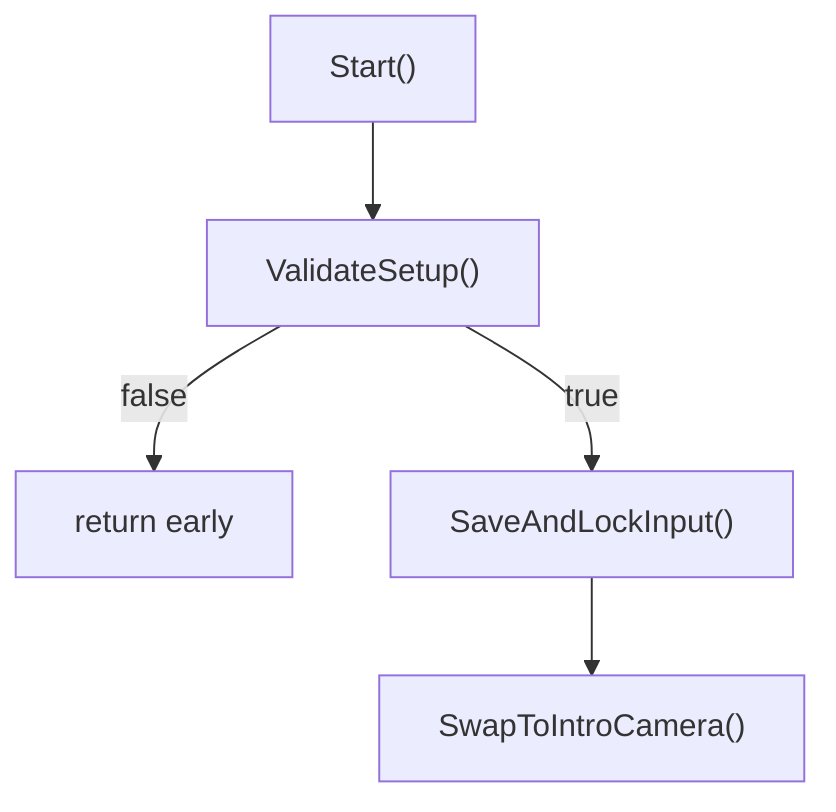

# Add Cutscene Lock + Refactor WakeUpIntro

Two goals: (1) give [AKFPSController](file:///media/tory/Media/HorrorHouse/Assets/Scripts/Adventure%20Puzzle%20Kit%20v1.7.1/Player/AKFPSController.cs#5-315) a cutscene lock method, and (2) clean up `WakeUpIntro.Start()` by breaking it into focused methods.

## Proposed Changes

### Player Controller

#### [MODIFY] [AKFPSController.cs](file:///media/tory/Media/HorrorHouse/Assets/Scripts/Adventure%20Puzzle%20Kit%20v1.7.1/Player/AKFPSController.cs)

**Add two private fields** for cursor state save/restore:

```csharp
private bool savedCursorVisible;
private CursorLockMode savedCursorLock;
```

**Add new method** `SetCutsceneLock(bool locked)`:

```csharp
// Locks the player for cutscenes/intros: disables movement, hides cursor, stops audio.
// Unlike SetPlayerDisableMode, cursor is hidden and locked (not shown).
public void SetCutsceneLock(bool locked)
{
    if (locked)
    {
        savedCursorVisible = Cursor.visible;
        savedCursorLock = Cursor.lockState;
        Cursor.visible = false;
        Cursor.lockState = CursorLockMode.Locked;
    }
    else
    {
        Cursor.visible = savedCursorVisible;
        Cursor.lockState = savedCursorLock;
    }

    canMove = !locked;
    canRotate = !locked;

    if (locked && playerAudioSource != null && playerAudioSource.isPlaying)
        playerAudioSource.Stop();
}
```

---

### WakeUpIntro Refactor

#### [MODIFY] [WakeUpIntro.cs](file:///media/tory/Media/HorrorHouse/Assets/Scripts/SceneManagement/WakeUpIntro.cs)

The current [Start()](file:///media/tory/Media/HorrorHouse/Assets/Scripts/SceneManagement/WakeUpIntro.cs#26-77) is a 50-line monolith that does four unrelated things. Break it into:



**1. `ValidateSetup() → bool`** — All the null checks and animator state validation (current lines 28–53). Returns `false` if anything is misconfigured.

```csharp
private bool ValidateSetup()
{
    if (gameplayCamera == null || introCamera == null || introAnimator == null ||
        gameplayCamera == introCamera || !introCamera.gameObject.activeInHierarchy ||
        !introAnimator.gameObject.activeInHierarchy || introAnimator.runtimeAnimatorController == null)
    {
        Debug.LogError("WakeUpIntro: assign two distinct cameras and an active intro Animator with a controller.", this);
        return false;
    }

    stateHash = Animator.StringToHash(stateName);
    introAnimator.enabled = true;
    if (!introAnimator.HasState(0, stateHash))
    {
        introAnimator.enabled = false;
        Debug.LogError("WakeUpIntro: missing Animator state " + stateName, this);
        return false;
    }

    introAnimator.Play(stateHash, 0, 0f);
    introAnimator.Update(0f);
    AnimatorStateInfo state = introAnimator.GetCurrentAnimatorStateInfo(0);
    if (state.loop || state.length <= 0f || introAnimator.speed <= 0f || state.speed * state.speedMultiplier <= 0f)
    {
        introAnimator.enabled = false;
        Debug.LogError("WakeUpIntro: WakeUp must be non-looping, with positive duration and playback speed.", this);
        return false;
    }

    return true;
}
```

**2. `SaveAndLockInput()`** — Saves previous `GameState.IsUsingSystem`, locks all input scripts. Cursor save/restore is now handled by `AKFPSController.SetCutsceneLock`.

```csharp
private void SaveAndLockInput()
{
    previousBusy = GameState.IsUsingSystem;
    GameState.IsUsingSystem = true;

    fpsController.SetCutsceneLock(true);

    LockAll<AKInteractor>();
    LockAll<AKCameraZoom>();
    LockAll<AKUIManager>();
    LockAll<FlashlightController>();
    LockAll<GasMaskController>();
    LockAll<GameStateControllerBehaviour>();

    if (additionalInputScripts != null)
        foreach (Behaviour script in additionalInputScripts) Lock(script);
}
```

**3. `SwapToIntroCamera()`** — The camera handoff.

```csharp
private void SwapToIntroCamera()
{
    previousCameraEnabled = gameplayCamera.enabled;
    introCamera.fieldOfView = gameplayCamera.fieldOfView;
    gameplayCamera.enabled = false;
    introCamera.enabled = true;
}
```

**4. [Start()](file:///media/tory/Media/HorrorHouse/Assets/Scripts/SceneManagement/WakeUpIntro.cs#26-77) becomes:**

```csharp
private void Start()
{
    if (!ValidateSetup()) return;
    playing = true;
    SaveAndLockInput();
    SwapToIntroCamera();
}
```

**5. [RestoreGameplay()](file:///media/tory/Media/HorrorHouse/Assets/Scripts/SceneManagement/WakeUpIntro.cs#117-131) updates:**
- Remove `Cursor.visible = previousCursorVisible` and `Cursor.lockState = previousCursorLock`
- Add `fpsController.SetCutsceneLock(false)` instead
- Remove the `previousCursorVisible` / `previousCursorLock` fields from the class

**6. New serialized field:**

```csharp
[SerializeField] private AKFPSController fpsController;
```

> [!NOTE]
> The remaining `LockAll<T>()` calls for `AKInteractor`, `AKUIManager`, etc. stay as-is for now. Those are a separate cleanup concern but could eventually move to a similar pattern through [AKDisableManager](file:///media/tory/Media/HorrorHouse/Assets/Scripts/Adventure%20Puzzle%20Kit%20v1.7.1/Core/AKDisableManager.cs#6-139).

## Verification Plan

### Manual Verification
1. **Compile check**: Open in Unity, confirm no Console errors
2. **Scene test**: Play a scene with [WakeUpIntro](file:///media/tory/Media/HorrorHouse/Assets/Scripts/SceneManagement/WakeUpIntro.cs#8-132) — animation should play with cursor hidden, then hand back control
3. **Pause during intro**: Confirm Escape still shows the cursor (the two disable paths don't collide)
